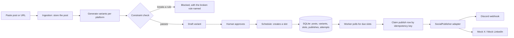

# Social Media Studio

Turn one blog post into reviewed, scheduled posts for X, LinkedIn and Discord,
and publish them without ever posting the same thing twice, even if the worker
crashes halfway through.

A person pastes in a post (or a URL). The app generates one variant per
platform, checks each against that platform's rules, and waits for a human to
approve it. Approved variants are scheduled, and a background worker publishes
them when they are due.

Discord is the real target (through a webhook). X and LinkedIn run on mock
adapters that record what they would have posted, and any platform can be
swapped between a real and a mock adapter with one setting.

## Which brief and which route

This is the current **Social Media Studio** capstone brief. The route I took:

- **Mock adapters: written myself.** `mock_x` and `mock_linkedin` implement
  the same `SocialPublisher` interface as the real adapter. Instead of
  posting, they record each send in a `mock_posts` table, so a duplicate send
  would show up as a second row.
- **Real free platform: a Discord webhook.** I first planned to publish to
  Telegram, but `api.telegram.org` was unreachable from my network, so I
  switched the real target to Discord. A real post is confirmed in my Discord
  channel (see section 4 of [EVIDENCE.md](EVIDENCE.md)).
- **No separate fake platform server.** The current brief has you write the
  adapters yourself instead of using a provided fake server.

## How a post flows



The code is split into layers: routes (HTTP only), services (all the rules),
adapters (one per platform, behind a single `SocialPublisher` interface) and
db (SQLite helpers). Services raise typed errors with a status code, and one
handler in `main.py` turns them into JSON responses.

## What it guarantees

- **Rules are enforced by code, not by hope.** Each platform has a profile
  (length, hashtags, tone). A variant that breaks a rule is blocked with a
  named error. The check runs on generation, on every edit, and again at
  approval.
- **Nothing unapproved is published.** Only approved variants can be
  scheduled, and a published variant cannot be approved again.
- **Never posts twice.** Each publish has a unique idempotency key
  (`v<variant>:s<slot>`). The publish row is claimed *before* the platform is
  called, so a second attempt cannot send.
- **Survives a crash.** If the worker stops mid-publish, a restart finds the
  stuck publish, looks the post up by its key, and settles it without sending
  again. With a platform that cannot be asked (real Discord), it is marked
  `uncertain` for a person to decide.
- **Every attempt is recorded.** `GET /publishes` and
  `GET /publishes/{id}/attempts` show the history.

Every claim above has a command and result in [EVIDENCE.md](EVIDENCE.md).

## Run it

Requires Python 3 and PowerShell (the commands are for Windows).

**1. Set up (once):**

```powershell
python -m venv .venv
.\.venv\Scripts\Activate.ps1
pip install -r requirements.txt
copy .env.example .env
```

Edit `.env`:

- Put your own Discord webhook in `DISCORD_WEBHOOK_URL`. **Never commit
  `.env`**; it is git-ignored.
- No webhook yet? Set `PUBLISH_ADAPTER_DISCORD=mock_x` in `.env`, and
  everything runs on mocks with nothing posted anywhere.

**2. Run (one command):**

```powershell
python run.py
```

This creates the database tables if they are missing, then starts the API
(on `http://127.0.0.1:8000`) and the worker together. Ctrl+C stops both.

**3. Seed sample data (second terminal):**

```powershell
.\.venv\Scripts\Activate.ps1
python seed.py
```

`seed.py` adds two demo posts with six approved slots that are due right
away. Watch the first terminal: the worker logs `slot 1` to `slot 6 ->
succeeded`. If `PUBLISH_ADAPTER_DISCORD` is `discord`, the two Discord slots
really post to your channel.

## Check it yourself: the six probes

Each probe below can be run against the live system. **Start from a fresh
database** (stop `run.py`, delete `social_studio.db`, start `python run.py`
again, and do not run `seed.py`), because the ids below assume an empty
database. If your ids differ, use the ids in each response.

Run these in a second PowerShell terminal.

**Probe 1: ingest a post, get a variant per platform.**

```powershell
'{"markdown": "# Hello\n\nA test post."}' | curl.exe -i -X POST http://127.0.0.1:8000/posts -H "Content-Type: application/json" --data-binary "@-"
curl.exe -i -X POST http://127.0.0.1:8000/posts/1/variants/generate
```

Expect `201` with `{"id":1}`, then `200` with three created variants (x,
linkedin, discord) and `"blocked":[]`.

**Probe 2: a rule-breaking variant is blocked, with the rule named.**

```powershell
'{"markdown": "# Big news!!\n\nSomething happened today."}' | curl.exe -i -X POST http://127.0.0.1:8000/posts -H "Content-Type: application/json" --data-binary "@-"
curl.exe -i -X POST http://127.0.0.1:8000/posts/2/variants/generate
```

Expect the `blocked` list to name the tone rule for x and linkedin (two
exclamation marks over the limit), while the discord variant is created.

**Probe 3: an unapproved variant cannot be scheduled.**

```powershell
$t = (Get-Date).ToUniversalTime().AddMinutes(2).ToString("yyyy-MM-ddTHH:mm:ssZ")
@{ scheduled_at = $t } | ConvertTo-Json -Compress | curl.exe -i -X POST http://127.0.0.1:8000/variants/1/schedule -H "Content-Type: application/json" --data-binary "@-"
```

Expect `409 Conflict` with an error saying variant 1 is draft and only
approved variants can be scheduled.

**Probe 4: approve, schedule two minutes out, and it publishes for real.**
Needs a real webhook in `.env` and `PUBLISH_ADAPTER_DISCORD=discord`.

```powershell
curl.exe -i -X POST http://127.0.0.1:8000/variants/3/approve
$t = (Get-Date).ToUniversalTime().AddMinutes(2).ToString("yyyy-MM-ddTHH:mm:ssZ")
@{ scheduled_at = $t } | ConvertTo-Json -Compress | curl.exe -i -X POST http://127.0.0.1:8000/variants/3/schedule -H "Content-Type: application/json" --data-binary "@-"
```

Wait about two minutes, until the worker logs `slot 1 -> succeeded`, then:

```powershell
curl.exe -i http://127.0.0.1:8000/publishes
```

Expect one publish with status `succeeded` whose `platform_message_id` is
Discord's message id. The message is in your channel.

**Probe 5: stop the worker mid-publish, restart, exactly one post.** See
"Crash-recovery demo" below. It resets the database.

**Probe 6: swap the adapter in configuration.** Stop `run.py`, then:

```powershell
$env:PUBLISH_ADAPTER_DISCORD = "mock_x"
python run.py
```

In the second terminal, approve and schedule variant 4 (the discord variant
from Probe 2):

```powershell
curl.exe -i -X POST http://127.0.0.1:8000/variants/4/approve
$t = (Get-Date).ToUniversalTime().AddMinutes(2).ToString("yyyy-MM-ddTHH:mm:ssZ")
@{ scheduled_at = $t } | ConvertTo-Json -Compress | curl.exe -i -X POST http://127.0.0.1:8000/variants/4/schedule -H "Content-Type: application/json" --data-binary "@-"
```

After about two minutes:

```powershell
python -c "from app.db.mock_posts import list_mock_posts; print(list_mock_posts())"
```

Expect a record from adapter `mock_x`, and nothing new in Discord. Only
configuration changed. Clear the setting afterwards:

```powershell
Remove-Item Env:PUBLISH_ADAPTER_DISCORD
```

### Crash-recovery demo (Probe 5)

This proves a worker stopped mid-publish does not lose or repeat a post. Stop
`run.py` first, so only one worker runs. It uses a fresh database and
overrides three settings for the terminal session only:

```powershell
Remove-Item .\social_studio.db
$env:PUBLISH_ADAPTER_DISCORD = "mock_x"
$env:MOCK_PUBLISH_DELAY_SECONDS = "4"
$env:STALE_AFTER_SECONDS = "5"

python seed.py
python worker.py     # press Ctrl+C right after "slot 2 -> succeeded"
python worker.py     # restart: logs "settled 1 stale publish(es)"
```

Then clear the settings:

```powershell
Remove-Item Env:PUBLISH_ADAPTER_DISCORD, Env:MOCK_PUBLISH_DELAY_SECONDS, Env:STALE_AFTER_SECONDS
```

Expected result: six mock posts, one per idempotency key, every publish
`succeeded`, and exactly one `recovered` attempt. The full output is in
section 6 of [EVIDENCE.md](EVIDENCE.md).

## Main endpoints

| Method and path | What it does |
|---|---|
| `POST /posts` | Store a post from `markdown` or a `url` |
| `POST /posts/{id}/variants/generate` | Generate and check one variant per platform |
| `PATCH /variants/{id}` | Edit a variant (re-validated, goes back to draft) |
| `POST /variants/{id}/approve` | Approve a draft |
| `POST /variants/{id}/reject` | Reject a draft or approved variant |
| `POST /variants/{id}/schedule` | Schedule an approved variant for a future UTC time |
| `POST /slots/{id}/publish` | Publish a slot now (the worker does this on schedule) |
| `GET /publishes` | List every publish |
| `GET /publishes/{id}/attempts` | List every attempt for one publish |

## Configuration

All settings live in `.env` (see `.env.example`): `DISCORD_WEBHOOK_URL`,
`DATABASE_PATH`, `BUSY_TIMEOUT_SECONDS`, `PUBLISH_ADAPTER_X`,
`PUBLISH_ADAPTER_LINKEDIN`, `PUBLISH_ADAPTER_DISCORD`, `STALE_AFTER_SECONDS`,
`POLL_INTERVAL_SECONDS` and `MOCK_PUBLISH_DELAY_SECONDS`.

## Known limitations

- Discord cannot say whether a post was made. A crash between sending and
  recording ends as `uncertain` for a person to decide. That path is designed
  but not run.
- The crash demo stops the worker with Ctrl+C. A forced kill, a crash before
  the send, and two workers running at once were not tested.
- The service returns errors as `{"error": ...}`, but FastAPI's own
  validation errors come back as `{"detail": ...}`. There are two error
  shapes.
- The worker retries a misconfigured slot on every poll instead of backing
  off.
- Fetching a user-supplied URL is unsafe on a public server, because a caller
  could point it at internal addresses. Fine on a local machine, not fine to
  deploy as it is.
- X and LinkedIn are mock adapters only.

## More

- [DESIGN.md](DESIGN.md): the design decisions
- [EVIDENCE.md](EVIDENCE.md): one proof per requirement
- [BUILDLOG.md](BUILDLOG.md): how AI was used, what went wrong, what I changed